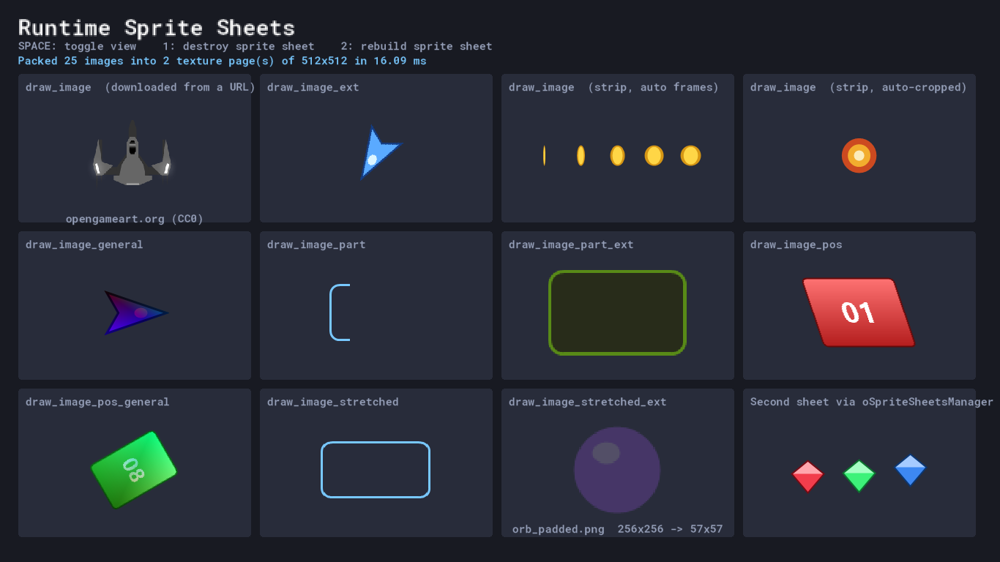
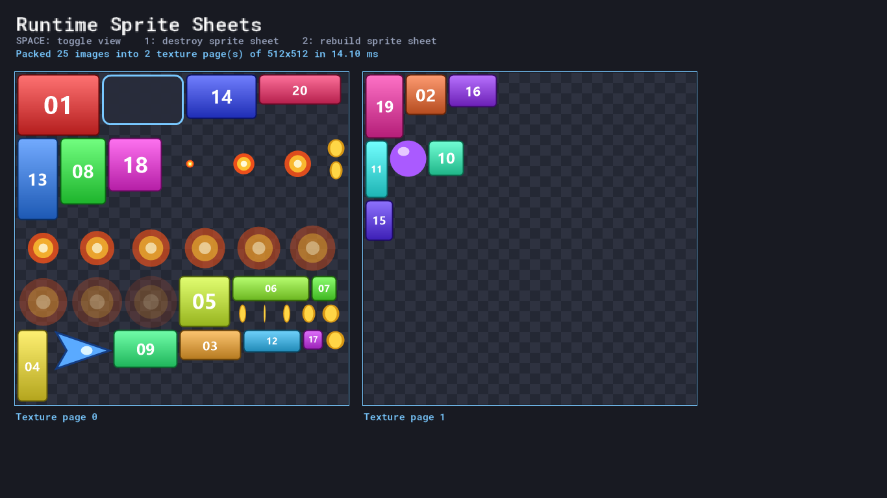

# Runtime Sprite Sheets

A GameMaker system that loads loose PNG files at runtime and packs them into texture pages on the GPU, so external art (downloaded, modded, CMS-driven or simply too numerous to bake into the project) can be drawn with the same batching benefits as compiled sprites.




*The demo packs 25 images (including two animated strips) into two 512×512 pages in about 14 ms, then draws them with every `draw_image_*` function.*

## Why

`sprite_add` gives every external image its own texture, so drawing 50 loaded images means 50 texture swaps per frame. This system packs those images onto a few shared texture pages at load time. Each image becomes a lightweight struct describing where it lives on a page, and the draw functions sample just that region.

## Features

- **Runtime bin packing:** images are sorted largest first and placed using guillotine splitting across as many pages as needed.
- **Animated strips:** pass `-1` as the frame count and the count is read from a `_stripN` file name suffix (for example `coin_strip8.png`).
- **Auto-crop:** optionally trims transparent padding using the sprite's bounding box before packing, and adjusts the origin to match.
- **Origin and pivot support:** origins are set as a 0 to 1 fraction, and rotation and scaling pivot correctly.
- **Full draw API:** a `draw_image_*` equivalent for each of GameMaker's `draw_sprite_*` functions (ext, part, general, pos, stretched).
- **Multiple sheets:** sheets are independent and named, and can be created and destroyed at any time to manage VRAM.
- **Load from disk or the web:** `texture_stream_add` accepts an Included Files path or an `http(s)` URL. Downloads are handled through the Async Image Loaded event, and the sheet only packs once every image has arrived or timed out.
- **Manager prefab:** `oSpriteSheetsManager` wraps the whole lifecycle so a sheet takes about 10 lines to set up.

## Requirements

GameMaker **2024.4** or newer. Open `RuntimeSpriteSheets.yyp` and run the project to see the demo.

| Demo key | Action |
| --- | --- |
| `SPACE` | Toggle between draw functions and the texture page view |
| `1` | Destroy the sprite sheet (frees all texture pages) |
| `2` | Rebuild the sprite sheet |

## Quick start

```gml
// Create
sheet_ = spritesheet_create("Enemies");
texture_stream_start(sheet_, 1024, 1024, 2);               // page width, height, padding

texture_stream_add(sheet_, "slime", "enemies/slime.png");   // origin defaults to the center
texture_stream_add(sheet_, "bat", "enemies/bat_strip6.png", -1);           // 6 frames from the file name
texture_stream_add(sheet_, "boss", "enemies/boss.png", 1, 0.5, 1, true);   // bottom-center origin, auto-crop

// Step: pack once every image has loaded (one frame on desktop, may be longer on HTML5)
if(texture_stream_exists(sheet_) && !texture_stream_loading(sheet_)) {
	texture_stream_finish(sheet_);
	slime_ = spritesheet_find_image(sheet_, "slime");
}

// Async - Image Loaded (only needed for HTML5)
texture_stream_async_image_loaded(sheet_);

// Draw
draw_image_ext(slime_, image_index, x, y, image_xscale, image_yscale, image_angle, c_white, 1);

// Clean Up
spritesheet_destroy(sheet_);
```

### Using the manager prefab

Make a child of `oSpriteSheetsManager` and override two callbacks. The manager creates the sheet, waits for loading, packs it, handles the HTML5 async event and frees everything in Clean Up.

```gml
// oEnemySheet - Create
event_inherited();
spriteSheet_ = "Enemies";

function spritesheet_add(_sheet) {
	texture_stream_add(_sheet, "slime", "enemies/slime.png");
	texture_stream_add(_sheet, "bat", "enemies/bat_strip6.png", -1);
}

function spritesheet_finish(_sheet) {
	// Every image is packed and ready to draw
}
```

The page size and padding are set in the object's Variable Definitions (`VAR_SPRITESHEET_SIZE`, `VAR_SPRITESHEET_TEX_SEPERATION`). `oDEMOManagerSheet` is a working example.

## How it works

```
texture_stream_add ──► TextureStreamImage ──► ds_priority (largest first)
   sprite_add()          crop, origin, size          │
                                                     ▼
texture_stream_finish ──► TexturePageSession
                            ├─ pop the largest image, find the smallest free area that fits
                            ├─ draw every frame to that page's surface, split the leftover space
                            ├─ start a new page when nothing fits
                            └─ sprite_create_from_surface() each page, then free the surfaces
                                                     │
                                                     ▼
                         TexturePageImage { page sprite, frame x/y, size, origin, bbox }
                                                     │
                                                     ▼
                         draw_image_* ──► draw_sprite_part / textured primitives
```

1. **Stream:** each added file is loaded with `sprite_add` and wrapped in a `TextureStreamImage`, which handles cropping and origin math. It is then pushed into a priority queue keyed on its size. On HTML5 the size isn't known until the download finishes, so the image's priority is updated when it arrives.
2. **Pack:** `TexturePageSession` pops images largest first. For each frame it picks the smallest free rectangle that fits on the earliest page with room, draws the frame there, and splits the leftover space into a "below" rectangle and a "right" rectangle. When nothing fits, it opens a new page surface.
3. **Bake:** each page surface becomes a single sprite via `sprite_create_from_surface`, and every image records which page holds each of its frames. The surfaces and the temporary per-file sprites are then freed.
4. **Draw:** each `draw_image_*` call maps to `draw_sprite_part*` (or a textured triangle list for the `pos` variants) against the page sprite, offset by the image's origin.

## API

### Sprite sheets
| Function | Description |
| --- | --- |
| `spritesheet_create(name)` | Creates a sheet. Returns the name, or `-1` if it already exists |
| `spritesheet_destroy(name)` | Frees all of a sheet's texture pages and removes the sheet |
| `spritesheet_clear(name)` | Frees a sheet's texture pages and images but keeps the sheet |
| `spritesheet_exists(name)` | Checks whether a sheet exists |
| `spritesheet_find_image(name, imageName)` | Returns a `TexturePageImage`, or `-1` if not found |
| `spritesheet_get_images(name)` | Returns a struct of every image in the sheet |
| `spritesheet_get_texturepage_count(name)` | Returns the number of pages the sheet packed into |
| `spritesheet_system_cleanup()` | Flushes textures from VRAM (they reload on next use) |

### Texture streams
| Function | Description |
| --- | --- |
| `texture_stream_start(name, width, height, [sep], [timeout])` | Begins collecting images for a sheet. Downloads still pending after `timeout` seconds (default 10, 0 waits forever) are skipped |
| `texture_stream_add(name, imageName, path, [subImg], [xOrig], [yOrig], [clamp], [removeBack])` | Queues an image. `subImg = -1` reads `_stripN`, and `clamp` auto-crops |
| `texture_stream_loading(name)` | Returns `true` while images are still downloading (HTML5) |
| `texture_stream_finish(name)` | Packs everything onto texture pages |
| `texture_stream_stop(name)` | Cancels a stream and frees any queued images |
| `texture_stream_async_image_loaded(name)` | Call this in the Async Image Loaded event |

### Drawing
`draw_image`, `draw_image_ext`, `draw_image_general`, `draw_image_part`, `draw_image_part_ext`, `draw_image_pos`, `draw_image_pos_ext`, `draw_image_pos_general`, `draw_image_stretched`, `draw_image_stretched_ext`, `draw_texturepage`, `draw_texturepage_all`

Each takes the same arguments as its `draw_sprite_*` equivalent, with a `TexturePageImage` in place of the sprite index.

### Settings (`scr_spritesheet_system_setup`)
| Macro | Description |
| --- | --- |
| `SPRITESHEET_DEBUG` | Fills texture pages with magenta so packed areas are visible |
| `SPRITESHEET_LOGGING` | Prints warnings and errors to the output console |

## Notes

- `draw_sprite_general` draws the whole texture page on HTML5, so `draw_image_general` and `draw_image_ext` draw textured quads instead. They work the same on every target.
- Images larger than a page (minus its padding) are rejected with a log message.
- **Web images on HTML5:** the browser only lets the game use an image from another domain if that server sends CORS headers (`Access-Control-Allow-Origin`). opengameart.org does not, so the URL demo cell works on desktop but shows "Download failed" in a browser. Host the images on your own server, or one that allows CORS, for HTML5 builds.
- After `spritesheet_destroy` or `spritesheet_clear`, any image structs you kept are stale. Look the images up again after rebuilding.

## Project layout

```
scripts/        The system (see the RuntimeSpriteSheets folder in the IDE)
objects/        oSpriteSheetsManager prefab, plus the demo objects
datafiles/      Demo PNGs loaded at runtime (Included Files)
docs/           Screenshots
```

## Credits

- "Simple Spaceship" by [ToxSickProductions](https://opengameart.org/content/simple-spaceship-0), CC0. The demo downloads it at runtime from opengameart.org.
